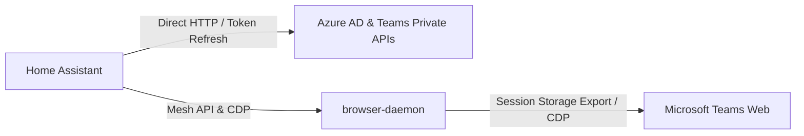

# Microsoft Teams for Home Assistant

[](https://github.com/pschmitt/homeassistant-msteams/actions/workflows/ci.yaml)
[](https://hacs.xyz)

Modern Microsoft Teams custom component for Home Assistant powered by Microsoft Teams private APIs and `browser-daemon` session management.

## Features

- **Sensors**:
  - `sensor.msteams_presence`: Current user presence (Available, Busy, In a meeting, Away, etc.) and custom status message.
  - `sensor.msteams_next_meeting`: Upcoming calendar meeting title, start/end time, organizer, and join URL.
  - `sensor.msteams_active_meeting`: Currently active meeting title and join link.
  - `sensor.msteams_unread_chats`: Unread chat conversations count.
- **Binary Sensors**:
  - `binary_sensor.msteams_in_a_meeting`: Indicates whether you are currently attending a meeting (from calendar schedule and real-time browser session).
  - `binary_sensor.msteams_meeting_muted`: Live microphone mute status in the active Teams web session.
  - `binary_sensor.msteams_connected`: Real-time API connection and token status.
- **Events**:
  - `event.msteams_meeting_event`: Lifecycle events (`meeting_started`, `meeting_ended`, `meeting_reminder`) include the meeting ID, title, join URL, description, start/end times, organizer, location, and participants when available. The ended event retains the last known meeting details.
- **Notifications**:
  - `notify.msteams`: Sends Markdown notifications to the configured default conversation, or your Teams notes if no default is set. Use `msteams.send_message` to select a conversation per message.
- **Buttons**:
  - `button.msteams_refresh_tokens`: Force immediate token refresh.
  - `button.msteams_toggle_mute`: Instantly toggle microphone mute in your active meeting via `browser-daemon`.
- **Services**:
  - `msteams.send_message`: Send messages to chats or channel threads.
  - `msteams.reply_message`: Threaded replies to existing messages.
  - `msteams.add_reaction`: React to messages with emojis (like, heart, laugh, surprised, sad, angry).
  - `msteams.toggle_mute` & `msteams.set_mute`: Direct meeting microphone controls.
- **Repairs**:
  - Interactive repair flow in Home Assistant when session credentials expire or reauthorization is needed.

## Architecture



1. **Initial Authentication**: Credentials and MSAL refresh tokens are extracted directly from a signed-in `browser-daemon` profile (e.g. `work`).
2. **Token Lifecycle**: Access tokens are refreshed via fast, direct HTTP requests to Azure AD without opening browser windows.
3. **Live updates**: An independent Teams push connection triggers refreshes for chat and call events. Periodic polling remains enabled for presence, calendar changes, and missed events.
4. **Meeting Controls**: Active meeting detection and microphone mute toggling are executed via `browser-daemon` and Chrome DevTools Protocol against the running Teams page.

## Installation

### Via HACS
1. Open HACS in Home Assistant.
2. Add `https://github.com/pschmitt/homeassistant-msteams` as a custom repository (Category: Integration).
3. Install and restart Home Assistant.

### Declarative / Local Submodule
Clone or submodule into `custom_components/msteams`:
```sh
ln -s ../custom_components-local/homeassistant-msteams/custom_components/msteams /config/custom_components/msteams
```

## Configuration

1. Go to **Settings** → **Devices & Services** → **Add Integration**.
2. Search for **Microsoft Teams**.
3. Enter your `browser-daemon` node URL (e.g. `https://browser.rofl-14.netbird.cloud`) and profile name (`work`).
4. Home Assistant extracts your credentials, discovers your account, and registers all devices and entities.

## License

MIT
